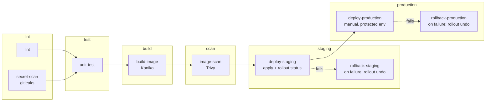

# gitlab-ci-k8s-templates

Reusable GitLab CI templates that lint, test, build (Kaniko), scan (gitleaks, Trivy) and deploy a containerised
app to Kubernetes or OpenShift, with a rollout gate and automatic rollback.

> Lab project: a clean-room reference implementation of a pattern I use at work. It contains no employer code or data.

## The problem

When every service team writes its own `.gitlab-ci.yml`, each team ends up with a slightly different deploy
pipeline. Some pipelines report success as soon as `kubectl apply` returns, before a single new pod is ready.
Some need a privileged Docker-in-Docker runner to build images. Some leave a broken rollout in place until
someone notices, and image tags drift to `latest`. Keeping these steps in one versioned set of templates means
that a fix to the deploy logic reaches every service when it bumps the template `ref`. The service repo keeps
only what is specific to it: manifests, a Dockerfile and a few variables.

## Pipeline



Merge requests and feature branches run lint, test, build and scan. Only the default branch deploys:
staging automatically, production after a person clicks "play" on `deploy-production`.

| Template | Jobs |
|----------|------|
| [templates/lint-test.gitlab-ci.yml](templates/lint-test.gitlab-ci.yml) | `lint`, `unit-test` |
| [templates/build-kaniko.gitlab-ci.yml](templates/build-kaniko.gitlab-ci.yml) | `build-image` |
| [templates/security.gitlab-ci.yml](templates/security.gitlab-ci.yml) | `secret-scan`, `image-scan` |
| [templates/deploy-kubernetes.gitlab-ci.yml](templates/deploy-kubernetes.gitlab-ci.yml) | `deploy-staging`, `rollback-staging`, `deploy-production`, `rollback-production` |
| [templates/deploy-openshift.gitlab-ci.yml](templates/deploy-openshift.gitlab-ci.yml) | OpenShift overlay for the deploy jobs (`oc` + token login) |

## Adopting the templates

1. Host this repository in your GitLab instance (for example as `platform/gitlab-ci-k8s-templates`) and tag a
   release.
2. In the app repository, add a `Dockerfile`, a `k8s/` folder of manifests whose container image is the literal
   `__IMAGE__`, and a `.gitlab-ci.yml` like [example/.gitlab-ci.yml](example/.gitlab-ci.yml):

   ```yaml
   include:
     - project: "platform/gitlab-ci-k8s-templates"
       ref: "v1.0.0"
       file:
         - templates/lint-test.gitlab-ci.yml
         - templates/build-kaniko.gitlab-ci.yml
         - templates/security.gitlab-ci.yml
         - templates/deploy-kubernetes.gitlab-ci.yml

   stages: [lint, test, build, scan, staging, production]

   variables:
     K8S_DEPLOYMENT: "hello-app"
     STAGING_KUBE_CONTEXT: "platform/k8s-agents:staging"
     PRODUCTION_KUBE_CONTEXT: "platform/k8s-agents:production"
   ```

3. Give the pipeline cluster access, with no credentials in the repository. Either:
   - connect the [GitLab agent for Kubernetes](https://docs.gitlab.com/ee/user/clusters/agent/) and set
     `STAGING_KUBE_CONTEXT` / `PRODUCTION_KUBE_CONTEXT`, or
   - add a File-type CI/CD variable `KUBECONFIG`, scoped to the `staging` or `production` environment.
4. Under Settings > CI/CD > Protected environments, protect `production` and choose who may deploy. GitLab then
   only lets those people run `deploy-production`.
5. For OpenShift, include `templates/deploy-openshift.gitlab-ci.yml` after the Kubernetes deploy template, and
   add `OPENSHIFT_SERVER` plus a masked `OPENSHIFT_TOKEN` (e.g. a service-account token) as CI/CD variables scoped
   per environment.

Override any default in your own top-level `variables:` or in project/group CI/CD settings. The templates
declare their defaults as top-level `variables:` on purpose. In GitLab, a variable set on a job wins over a
top-level one, so defaults set on the jobs could not be overridden from your top-level `variables:`.

The [example/](example/) folder stands in for an app repository: a stdlib-only Python HTTP service with
`/healthz`, its unit tests, a Dockerfile (non-root, numeric UID), and manifests for a Deployment (readiness and
liveness probes, requests/limits, `maxUnavailable: 0` rolling update, hardened security context), a Service and a
PodDisruptionBudget.

## Variables

| Variable | Default | Purpose |
|----------|---------|---------|
| `APP_DIR` | `.` | Directory where lint and test commands run |
| `LINT_IMAGE` | `python:3.12.7-slim` | Image for `lint` |
| `LINT_COMMAND` | `pip install --quiet ruff==0.7.4 && ruff check .` | Lint command |
| `TEST_IMAGE` | `python:3.12.7-slim` | Image for `unit-test` |
| `TEST_COMMAND` | `python -m unittest discover -v` | Unit test command |
| `KANIKO_IMAGE` | `gcr.io/kaniko-project/executor:v1.24.0-debug` | Kaniko executor (the `-debug` tag has the shell CI needs) |
| `BUILD_CONTEXT` | `.` | Build context, relative to the repository root |
| `DOCKERFILE_PATH` | `Dockerfile` | Dockerfile, relative to the repository root |
| `IMAGE_NAME` | `$CI_REGISTRY_IMAGE` | Image repository to push to and deploy |
| `IMAGE_TAG` | `$CI_COMMIT_SHORT_SHA` | Tag to push and deploy (immutable per commit) |
| `KANIKO_CACHE` | `true` | Cache layers in `$IMAGE_NAME/cache` |
| `KANIKO_EXTRA_ARGS` | empty | Extra executor flags, e.g. `--build-arg VERSION=1.2.3` |
| `GITLEAKS_IMAGE` | `zricethezav/gitleaks:v8.21.2` | Secret scanner |
| `GITLEAKS_ARGS` | empty | Extra gitleaks flags, e.g. `--config .gitleaks.toml` |
| `TRIVY_IMAGE` | `aquasec/trivy:0.57.1` | Image scanner |
| `TRIVY_SEVERITY` | `CRITICAL` | Severities that fail the scan, e.g. `HIGH,CRITICAL` |
| `TRIVY_IGNORE_UNFIXED` | `false` | `true` ignores CVEs that have no fixed version yet |
| `TRIVY_EXIT_CODE` | `1` | `0` reports findings without failing the pipeline |
| `KUBE_CLI` | `kubectl` (`oc` with the OpenShift overlay) | CLI used by deploy and rollback |
| `KUBE_CLI_IMAGE` | `alpine/k8s:1.31.2` (`quay.io/openshift/origin-cli:4.16`) | Image for deploy and rollback |
| `K8S_MANIFESTS` | `k8s` | Directory of `*.yaml` manifests; `__IMAGE__` is replaced with `$IMAGE_NAME:$IMAGE_TAG` |
| `K8S_DEPLOYMENT` | `$CI_PROJECT_NAME` | Deployment to gate on and roll back |
| `K8S_CONTAINER` | `app` | Container in that Deployment that runs the built image |
| `ROLLOUT_TIMEOUT` | `180s` | How long `rollout status` waits before the deploy fails |
| `STAGING_NAMESPACE` | `$CI_PROJECT_NAME-staging` | Staging namespace |
| `STAGING_KUBE_CONTEXT` | empty | Agent context for staging; empty means use `KUBECONFIG` |
| `PRODUCTION_NAMESPACE` | `$CI_PROJECT_NAME` | Production namespace |
| `PRODUCTION_KUBE_CONTEXT` | empty | Agent context for production; empty means use `KUBECONFIG` |
| `OPENSHIFT_INSECURE_SKIP_TLS_VERIFY` | `false` | OpenShift overlay only; leave `false` outside a lab |
| `OPENSHIFT_SERVER`, `OPENSHIFT_TOKEN` | none (set as CI/CD variables) | OpenShift overlay only: API URL and masked token |

All images are pinned to exact versions. Bump them deliberately in a template release.

## How deploy and rollback work

1. `deploy-<env>` copies `$K8S_MANIFESTS/*.yaml` into `rendered/`, replacing `__IMAGE__` with the commit's image.
   It runs `kubectl apply` and then `kubectl rollout status deployment/$K8S_DEPLOYMENT --timeout=$ROLLOUT_TIMEOUT`.
   The rendered manifests are kept as a job artifact. A rollout that does not finish in time fails the job. That
   happens when new pods never pass their readiness probe, crash-loop or cannot be scheduled. With
   `maxUnavailable: 0`, the old pods keep serving the whole time.
2. `rollback-<env>` has `needs: [deploy-<env>]` and `when: on_failure`, so it only runs when that deploy failed.
   It first checks that the Deployment's container image actually is this pipeline's image. If `apply` failed
   before anything changed, there is nothing to undo, and an unconditional `rollout undo` would wrongly step back
   from the healthy revision to the one before it. If the image matches, it runs `kubectl rollout undo` and waits
   for the previous revision to be healthy again. The pipeline stays failed, so the bad commit remains visible.
3. `resource_group` serialises deploys and rollbacks per environment, so two pipelines never roll the same
   Deployment at once.
4. Production gets the same image tag that passed staging and the scan. It is never rebuilt.

## Checks

GitHub Actions ([.github/workflows/ci.yml](.github/workflows/ci.yml)) runs:

- `yamllint --strict .` on all YAML (config in `.yamllint.yml`).
- `pytest -q`. The tests load the templates and reproduce GitLab's include, merge and `extends` resolution.
  They assert that stages and `needs` are consistent, that every variable a script uses is defined, that every
  image is pinned (no `latest`), that the deploy gates on `rollout status --timeout`, and that each rollback job
  exists, runs only `on_failure` of its deploy and guards `rollout undo`. They also check that production is a
  manual promotion, that the OpenShift overlay swaps in `oc login`, that this README documents every template
  variable, and that the example manifests keep probes, resources, `maxUnavailable: 0` and matching selectors.
- The example app's unit tests.
- `kubeconform -strict` (checksum-verified v0.6.7) on `example/k8s/` against the Kubernetes 1.31 schemas.

Run locally:

```bash
python -m venv .venv && . .venv/bin/activate    # Windows: py -3 -m venv .venv && .venv\Scripts\activate
pip install -e ".[dev]"
yamllint --strict . && pytest -q
(cd example && python -m unittest discover -v)
```

## Limitations

- The templates have not been run here against a live GitLab instance or cluster. GitLab's own CI Lint is the
  final word on syntax; the pytest suite only approximates GitLab's merge rules.
- `__IMAGE__` substitution is plain `sed`. Projects that already use Helm or Kustomize should swap the render
  step for `helm upgrade --install --wait` or `kubectl apply -k`.
- The rollout gate and rollback cover one Deployment per pipeline (`K8S_DEPLOYMENT`). Other resources in the
  manifests (ConfigMaps, Services) are applied but not rolled back.
- Images are pushed before the Trivy scan, tagged with the commit SHA. Nothing deploys an image that failed the
  scan, but the image does exist in the registry.
- Upstream Kaniko was archived by Google in 2025. The pinned image still works; for long-term use, consider a
  maintained fork or Buildah.
